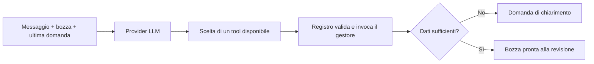

# Kairos

Assistente personale per chi procrastina: trasformare intenzioni in piccoli passi concreti. Android è la prima piattaforma prevista; italiano e inglese sono le lingue iniziali.

## Stato attuale

Il backend Python implementa il primo workflow di preparazione di una bozza di evento: dati strutturati, attività prima/dopo, più promemoria, chiarimenti e aggiornamenti su più turni. Il risultato è una bozza in memoria pronta alla revisione. Non sono ancora implementati salvataggio, notifiche, API HTTP, voce e app mobile.

La prima POC si concentra sul percorso da un impegno alle azioni necessarie per affrontarlo. La lista della spesa è esclusa dalla POC: rimane un'idea futura, da rivalutare solo con un legame chiaro con il supporto a chi procrastina, evitando di accumulare funzionalità scollegate.

## Avvio locale

Con Python 3.13 e uv, dalla radice del repository:

```bash
cd backend
uv sync --dev
uv run pytest
uv run python -m kairos
```

La demo usa due tool call predefinite e non chiama un modello: dimostra la conservazione dello stato fra richiesta iniziale e scelta dei promemoria. Non interpreta frasi arbitrarie. `uv sync` genera anche il lockfile; conservarlo in Git per condividere le versioni risolte. L'ambiente `.venv` rimane locale.

Per la conversazione reale, occorrono Ollama avviato su `localhost:11434` e un modello già installato che supporti il tool calling. Sostituire `NOME_MODELLO` con il nome effettivo:

```bash
uv run python -m kairos --model NOME_MODELLO --language it --timezone Europe/Rome
```

Usare `--language en` per i testi della CLI e i dati dimostrativi in inglese, e `/exit` per terminare. Le domande nella struttura JSON contengono tutte le lingue supportate; un'interfaccia seleziona il testo tramite il codice lingua. La data corrente è letta all'avvio della CLI: per una nuova sessione dopo un cambio di giorno riavviare il processo. Nessun modello viene scaricato automaticamente. Il nome del modello è configurabile; qualità dell'estrazione e rispetto delle istruzioni vanno valutati sul modello scelto.

In VS Code selezionare `backend/.venv/bin/python` come interprete. I percorsi per Pylance e pytest sono già configurati.

## Come funziona il workflow



- `backend/src/kairos/models/event.py`: dati e vincoli di base.
- `backend/src/kairos/contracts.py`: contratti condivisi di stato, contesto, chiamate e risultati.
- `backend/src/kairos/workflow.py`: avanzamento della conversazione e scelta del prossimo passo.
- `backend/src/kairos/tools.py`: registro, schemi tipizzati, disponibilità e gestori dei tool.
- `backend/src/kairos/i18n.py` e `locales/messages.json`: lingue e messaggi completi, validati all'avvio.
- `backend/src/kairos/providers.py`: prompt e adattatore HTTP Ollama; provider simulato per test e demo.
- `backend/src/kairos/__main__.py`: CLI dimostrativa.

Ogni turno fa al massimo una richiesta al modello e accetta esattamente una tool call autorizzata. Python valida gli argomenti prima di applicarli; campi omessi preservano i dati esistenti e `null` cancella i campi facoltativi. Le liste fornite sostituiscono la lista precedente: il modello riceve quella corrente e deve conservarne gli elementi non rimossi dall'utente. `reminders=null` richiede una scelta; `[]` significa nessun promemoria.

Il workflow mantiene la bozza e l'ultima domanda, non una memoria completa della conversazione. Input storici non strutturati non sono recuperabili. Il risultato del tool diventa direttamente lo stato mostrato all'utente: non serve una seconda chiamata al modello per scrivere una frase di conferma.

### Registro dei tool

Il modello può scegliere `update_event_draft` per aggiornare dati oppure `ask_event_clarification` per chiedere un chiarimento senza modificare i campi dell'evento. Il registro espone solo i tool disponibili nello stato corrente e ricontrolla la disponibilità prima dell'esecuzione. Ogni definizione associa nome, descrizione per il modello, schema Pydantic e gestore Python; nomi duplicati, tool sconosciuti e argomenti invalidi sono rifiutati.

Il limite di una chiamata per turno è indipendente dal numero di tool fra cui scegliere. Aggiungere un tool significa registrare una nuova capacità con argomenti, gestore e regole di disponibilità; azioni esterne richiederanno anche autorizzazioni, conferme e gestione degli effetti, non ancora implementate. Il registro attuale è specifico del workflow evento e non è un motore universale per ogni futuro agente.

### Contratto multilingua

`Language` dichiara le lingue supportate. `MessageId` dichiara tutti i messaggi dell'applicazione: domande predefinite, errori applicativi e testi della CLI. Il catalogo JSON usa le sigle come chiavi. All'avvio sono rifiutati messaggi mancanti o sconosciuti, traduzioni mancanti, lingue non supportate e testi vuoti. Aggiungere una lingua richiede completare il catalogo, senza cambiare rami condizionali nel workflow.

Anche le domande generate dal modello devono rispettare `LocalizedText`: lo schema inviato al LLM richiede tutte le lingue supportate e Python verifica lo stesso contratto. `state.question` è quindi un dizionario multilingua; `state.question.text(context.language)` seleziona il testo da mostrare. Il modello produce più testo rispetto a una risposta in una sola lingua: è un costo esplicito di questo contratto. La validazione verifica copertura e struttura, non la correttezza semantica delle traduzioni.

Titoli e descrizioni forniti dall'utente restano dati originali e non vengono tradotti automaticamente. Identificatori di stato/tool, prompt interni, diagnostica degli strumenti e messaggi standard di argparse non sono testi dell'interfaccia applicativa.

## Confini e verifiche

Il modello può proporre modifiche alla bozza, non eseguire comandi o strumenti arbitrari. I vincoli Python rifiutano argomenti extra, valori invalidi e tool sconosciuti. Errori del provider lasciano invariato lo stato precedente. Sono previsti timeout HTTP, un limite alla lunghezza dei messaggi e un limite ai turni. Gli orari locali inesistenti o ambigui al cambio dell'ora e gli offset incoerenti richiedono chiarimento.

Queste misure sono un primo confine di esecuzione, non una protezione completa dalla prompt injection: il modello può ancora proporre dati semanticamente errati. La revisione dell'utente resta necessaria prima di introdurre salvataggio e azioni esterne. I test simulano le risposte LLM e l'HTTP; non misurano qualità, latenza o affidabilità di un modello reale. Il workflow non garantisce ancora che ogni promemoria futuro sia materialmente pianificabile.

Protocollo di riferimento per l'adattatore: [tool calling Ollama](https://docs.ollama.com/capabilities/tool-calling) e [API chat](https://docs.ollama.com/api/chat).

## Note di progetto

- [Documento Word dei requisiti](docs/requirements/Kairos_Requisiti_Funzionali.docx)
- [Requisiti funzionali e sintesi per stakeholder](docs/working/functional-requirements.md)
- [Registro delle idee](docs/working/ideas.md)
- [Proposte di prodotto](docs/working/product-proposals.md)
- [Primo workflow e percorso didattico](docs/development/first-workflow.md)
- [Team e deleghe](docs/working/team.md)

La documentazione segue questa struttura:

```text
docs/
├── requirements/
│   └── Kairos_Requisiti_Funzionali.docx
├── working/
│   ├── functional-requirements.md
│   ├── ideas.md
│   ├── product-proposals.md
│   └── team.md
└── development/
    └── first-workflow.md
```

Il Word è la versione presentabile; la fonte dei contenuti è `docs/working/functional-requirements.md`. Lo script `scripts/build_functional_document.py` rigenera il documento a partire dalla fonte, applicando frontespizio e stili. Richiede `python-docx`, separato dalle dipendenze applicative. Alle revisioni significative si aggiorna la fonte, si rigenera il Word e si controlla l'impaginazione. Le modifiche fatte direttamente in Word vanno riportate alla fonte prima di una nuova generazione.
