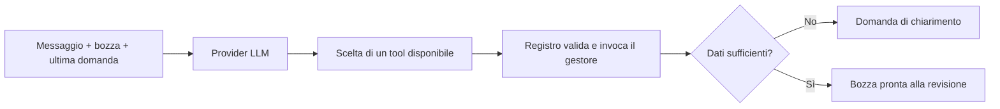

# Kairos

Assistente personale per chi procrastina: trasformare intenzioni in piccoli passi concreti. Android è la prima piattaforma prevista; italiano e inglese sono le lingue iniziali.

## Stato attuale

Il backend Python implementa il primo workflow di preparazione di una bozza di evento: dati strutturati, attività prima/dopo, più promemoria, chiarimenti e aggiornamenti su più turni. La data, l'ora locale e il fuso restano campi distinti; un orario mancante non viene rappresentato come mezzanotte. Il risultato è una bozza in memoria pronta alla revisione. Non sono ancora implementati salvataggio, notifiche, API HTTP, voce e app mobile.

La prima POC si concentra sul percorso da un impegno alle azioni necessarie per affrontarlo. La lista della spesa è esclusa dalla POC: rimane un'idea futura, da rivalutare solo con un legame chiaro con il supporto a chi procrastina, evitando di accumulare funzionalità scollegate.

## Avvio locale

Con Python 3.13 e uv, dalla radice del repository:

```bash
cd backend
uv sync --dev
uv run pytest
uv run python -m kairos
```

La demo usa due tool call predefinite e non chiama un modello: dimostra la conservazione dello stato fra richiesta iniziale e scelta dei promemoria. Non interpreta frasi arbitrarie. La CLI mostra un riepilogo leggibile della bozza, la domanda o lo stato pronto, ma non il testo libero prodotto dal modello. Per la sessione Ollama, le opzioni `--debug-model-io`, `--debug-draft-json` e `--debug-validation` attivano separatamente le rispettive diagnostiche; `--debug` è una scorciatoia che le abilita tutte. L'I/O del modello (payload effettivamente inviato e risposta ricomposta dai frame di streaming, con il conteggio dei frame e senza il campo `thinking`) viene scritto una volta su stderr al termine dello stream; il JSON della bozza resta su stdout e gli errori tecnici di validazione su stderr. Questi log possono contenere messaggi utente, dati personali e istruzioni del prompt: abilitarli solo quando serve e proteggere l'output raccolto. I colori diagnostici sono usati solo nei terminali compatibili e rispettano `NO_COLOR`; non si avvia il debugger di VS Code. `uv sync` genera anche il lockfile; conservarlo in Git per condividere le versioni risolte. L'ambiente `.venv` rimane locale.

Per la conversazione reale, occorrono Ollama avviato su `localhost:11434` e un modello già installato che supporti il tool calling. Sostituire `NOME_MODELLO` con il nome effettivo:

```bash
uv run python -m kairos --model NOME_MODELLO --language it --timezone Europe/Rome
```

Usare `--language en` per i testi della CLI e i dati dimostrativi in inglese, `--think` per abilitare esplicitamente il ragionamento interno del modello, e `/exit` per terminare. Il ragionamento non viene mostrato. Senza `--think` la CLI invia `think=false`; gli altri chiamanti di `OllamaEventProvider` mantengono il default del modello. `--language` imposta la lingua dell'interfaccia e quella iniziale della conversazione; il modello può cambiare lingua nella stessa chiamata se l'utente la chiede esplicitamente o scrive un messaggio sostanziale chiaramente in italiano o inglese. Se il messaggio sostanziale è chiaramente in una lingua non supportata, la conversazione passa all'inglese. Una richiesta esplicita di usare italiano o inglese prevale anche se scritta in un'altra lingua. Risposte ambigue o neutre, come "ok" o una data isolata, mantengono la lingua precedente; un saluto chiaramente in un'altra lingua segue le regole del modello. Progressi e messaggi statici restano nella lingua UI. La data corrente è letta all'avvio della CLI: per una nuova sessione dopo un cambio di giorno riavviare il processo. Nessun modello viene scaricato automaticamente. Il nome del modello è configurabile; qualità dell'estrazione e rispetto delle istruzioni vanno valutati sul modello scelto.

In VS Code selezionare `backend/.venv/bin/python` come interprete. I percorsi per Pylance e pytest sono già configurati.

La valutazione sperimentale in [docs/development/prompt-evaluation.md](docs/development/prompt-evaluation.md) e i relativi output sono snapshot storici. Il benchmark appartiene anche al vecchio schema `starts_at` e non è compatibile con l'attuale contratto `start_date`/`start_time`; il report non è stato riscritto.

## Come funziona il workflow



- `backend/src/kairos/models/event.py`: dati e vincoli di base.
- `backend/src/kairos/contracts.py`: contratti condivisi di stato, contesto, chiamate e risultati.
- `backend/src/kairos/workflow.py`: avanzamento della conversazione e scelta del prossimo passo.
- `backend/src/kairos/tools.py`: registro, schemi tipizzati, disponibilità e gestori dei tool.
- `backend/src/kairos/i18n.py` e `locales/messages.json`: lingue e messaggi completi, validati all'avvio.
- `backend/src/kairos/providers.py`: prompt e adattatore HTTP Ollama; provider simulato per test e demo.
- `backend/src/kairos/__main__.py`: CLI dimostrativa.

Ogni turno fa al massimo una richiesta al modello e accetta esattamente una tool call autorizzata. L'adattatore usa `stream=true` e legge frame NDJSON fino a `done=true`; testo e chiamate strutturate sono canali distinti. Il testo può apparire progressivamente, ma gli argomenti dei tool restano interni finché il flusso non termina: il workflow esegue solo una chiamata completa e valida. Se il flusso si interrompe o la tool call non supera la validazione, lo stato applicativo precedente resta invariato. Il testo streamed è provvisorio e non conferma l'aggiornamento: un errore tardivo può arrivare dopo che alcuni caratteri sono stati mostrati. Il campo `thinking` non viene mostrato. Python valida gli argomenti prima di applicarli; campi omessi preservano i dati esistenti e `null` cancella i campi facoltativi. Le attività si modificano tramite operazioni esplicite `task_operations.add` e `task_operations.remove`: le rimozioni fanno riferimento alla descrizione esistente e Python applica la rimozione solo se trova una corrispondenza univoca. Per tollerare modelli che restituiscono ancora `patch.tasks`, il backend confronta gli elementi proposti con la bozza corrente: le attività già presenti non vengono riaggiunte, quelle nuove diventano aggiunte esplicite; l'omissione di un'attività non la rimuove. Se la lista legacy omette attività esistenti senza una nuova attività o una rimozione esplicita che chiarisca l'intento, il workflow chiede conferma. Le altre liste fornite sostituiscono la lista precedente; il modello riceve quella corrente e deve conservarne gli elementi non rimossi dall'utente. `reminders=null` richiede una scelta; `[]` significa nessun promemoria. Nel turno in cui si risponde alla domanda sui promemoria, il backend ignora le modifiche agli altri campi: un orario assoluto come `alle 11` diventa un promemoria a quell'ora nello stesso giorno, purché sia prima dell'inizio e non ambiguo nel fuso; altrimenti chiede un chiarimento senza spostare l'impegno. Gli intervalli relativi continuano a usare `minutes_before`. Quando data, ora e fuso sono noti, il workflow rifiuta un promemoria il cui istante previsto (`inizio evento − minutes_before`) è già passato; questo controllo non invia né pianifica notifiche.

Il workflow mantiene la bozza, l'ultima domanda e la lingua della conversazione, non una memoria completa della conversazione. Input storici non strutturati non sono recuperabili. La lingua dell'interfaccia (`RequestContext.language`) resta separata da `EventWorkflowState.conversation_language`; quest'ultima è proposta e validata nella stessa tool call che aggiorna la bozza. Se non è presente o il messaggio è breve/ambiguo, si usa la lingua precedente oppure, all'inizio, quella dell'interfaccia. Non c'è un rilevatore o una chiamata LLM aggiuntiva.

`stream_advance` emette progressi statici prima della richiesta e prima della validazione, testo opzionale man mano che arriva e l'evento `completed` solo dopo l'applicazione riuscita della tool call. I progressi e gli errori statici seguono la lingua UI (`RequestContext.language`); domande e testo streamed seguono la lingua della conversazione. `advance` resta disponibile e consuma gli stessi eventi per i chiamanti non streaming. La CLI normale mostra i progressi, poi la domanda o lo stato pronto e l'intera bozza validata. I flag diagnostici non cambiano inferenza né flusso applicativo, ma solo ciò che viene scritto nei rispettivi stream CLI. I progressi indicano solo fasi realmente raggiunte, non simulano attese.

### Registro dei tool

Il modello può scegliere `update_event_draft` per aggiornare dati oppure `ask_event_clarification` per chiedere un chiarimento senza modificare i campi dell'evento. Il registro espone solo i tool disponibili nello stato corrente e ricontrolla la disponibilità prima dell'esecuzione. Ogni definizione associa nome, descrizione per il modello, schema Pydantic e gestore Python; nomi duplicati, tool sconosciuti e argomenti invalidi sono rifiutati.

Il limite di una chiamata per turno è indipendente dal numero di tool fra cui scegliere. Aggiungere un tool significa registrare una nuova capacità con argomenti, gestore e regole di disponibilità; azioni esterne richiederanno anche autorizzazioni, conferme e gestione degli effetti, non ancora implementate. Il registro attuale è specifico del workflow evento e non è un motore universale per ogni futuro agente.

### Contratto multilingua

`Language` dichiara le lingue supportate. `MessageId` dichiara tutti i messaggi dell'applicazione: domande predefinite, errori applicativi e testi della CLI. Il catalogo JSON usa le sigle come chiavi. All'avvio sono rifiutati messaggi mancanti o sconosciuti, traduzioni mancanti, lingue non supportate e testi vuoti. Aggiungere una lingua richiede completare il catalogo, senza cambiare rami condizionali nel workflow.

Le domande statiche generate dall'app usano il catalogo completo. Una domanda di chiarimento prodotta dal modello è invece una singola stringa non vuota nella lingua corrente della conversazione. La tool call può proporre `conversation_language` usando solo `it` o `en`; Python convalida il valore e la persistenza in memoria conserva la scelta. Per input chiaramente in una lingua non supportata, il prompt richiede inglese; un valore non supportato restituito dal modello viene rifiutato dalla validazione. La comprensione della lingua del messaggio è affidata al modello e al prompt, non a euristiche applicative. Il test con provider simulato verifica payload, persistenza e precedenza delle regole, ma non la qualità del riconoscimento sul modello reale.

Titoli e descrizioni forniti dall'utente restano dati originali e non vengono tradotti automaticamente. Identificatori di stato/tool, prompt interni, diagnostica degli strumenti e messaggi standard di argparse non sono testi dell'interfaccia applicativa.

## Confini e verifiche

Il modello può proporre modifiche alla bozza, non eseguire comandi o strumenti arbitrari. I vincoli Python rifiutano argomenti extra, valori invalidi e tool sconosciuti. Errori del provider lasciano invariato lo stato precedente. Sono previsti timeout HTTP, un limite alla lunghezza dei messaggi e un limite ai turni. Gli orari locali inesistenti o ambigui al cambio dell'ora e gli offset incoerenti richiedono chiarimento.

Queste misure sono un primo confine di esecuzione, non una protezione completa dalla prompt injection: il modello può ancora proporre dati semanticamente errati. La revisione dell'utente resta necessaria prima di introdurre salvataggio e azioni esterne. I test simulano le risposte LLM e l'HTTP; non misurano qualità, latenza o affidabilità di un modello reale. Il workflow non garantisce ancora che ogni promemoria futuro sia materialmente pianificabile.

Protocollo di riferimento per l'adattatore: [tool calling Ollama](https://docs.ollama.com/capabilities/tool-calling) e [API chat](https://docs.ollama.com/api/chat).

## Note di progetto

- [Documento Word dei requisiti](docs/requirements/Kairos_Requisiti_Funzionali.docx)
- [Requisiti funzionali e sintesi per stakeholder](docs/working/functional-requirements.md)
- [Registro delle idee](docs/working/ideas.md)
- [Proposte di prodotto](docs/working/product-proposals.md)
- [Primo workflow e percorso didattico](docs/development/first-workflow.md)
- [Team e deleghe](docs/working/team.md)

La documentazione segue questa struttura:

```text
docs/
├── requirements/
│   └── Kairos_Requisiti_Funzionali.docx
├── working/
│   ├── functional-requirements.md
│   ├── ideas.md
│   ├── product-proposals.md
│   └── team.md
└── development/
    └── first-workflow.md
```

Il Word è la versione presentabile; la fonte dei contenuti è `docs/working/functional-requirements.md`. Lo script `scripts/build_functional_document.py` rigenera il documento a partire dalla fonte, applicando frontespizio e stili. Richiede `python-docx`, separato dalle dipendenze applicative. Alle revisioni significative si aggiorna la fonte, si rigenera il Word e si controlla l'impaginazione. Le modifiche fatte direttamente in Word vanno riportate alla fonte prima di una nuova generazione.
