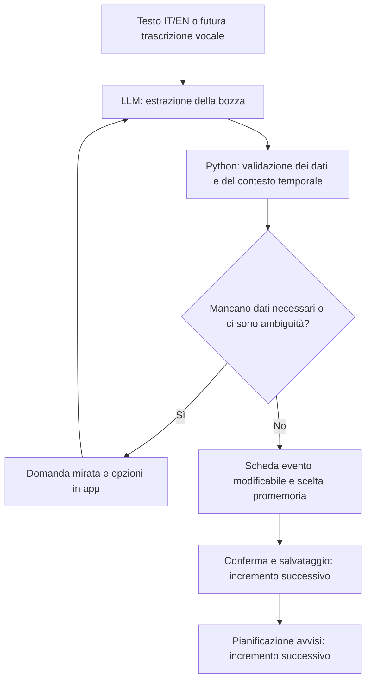

# Primo workflow: da una frase a una bozza di evento

Schema proposto dal coordinatore il 24 ottobre 2026, sulla base del [registro delle idee](../working/ideas.md). Il primo incremento è ora implementato nel backend: modelli Pydantic, workflow asincrono, provider simulato, adattatore Ollama e CLI. Lo stato operativo e i comandi sono nel [README](../../README.md). Salvataggio, notifiche, API e frontend restano incrementi successivi; lo schema seguente mostra anche queste tappe future.

## Obiettivo

Ricevere una frase in italiano o inglese e ottenere una bozza strutturata di evento, attività prima/dopo e promemoria. Il primo esercizio parte da testo; voce, salvataggio e notifiche sono incrementi successivi dello stesso flusso.

Il ciclo mantiene la bozza precedente e applica le nuove risposte: non perde i dati già raccolti. I promemoria non specificati richiedono una scelta esplicita; fra le opzioni si propone anche di non riceverne. La conferma finale è una proposta di interazione da valutare.

## Dati da rappresentare

| Oggetto | Contenuto proposto |
| --- | --- |
| Evento in bozza | Titolo, data e ora, fuso orario di riferimento, luogo e durata quando disponibili |
| Attività collegata | Descrizione, relazione prima/dopo, eventuale scadenza esplicita |
| Promemoria | Momento assoluto oppure anticipo rispetto all'evento; zero o più dopo la scelta dell'utente |
| Stato del flusso | Bozza corrente, informazioni mancanti, domanda in attesa, pronto alla revisione |
| Contesto della richiesta | Istante di riferimento, lingua e fuso noti o da chiarire |

Una visita non autorizza a inferire diagnosi o istruzioni mediche. Una relazione prima/dopo non assegna automaticamente una scadenza precisa. Informazioni mancanti restano tali; il codice verifica date, durata e orari, e chiede chiarimenti quando necessari. L'istante di riferimento e il fuso sono forniti dall'applicazione, non inventati dal modello.

## Italiano e inglese

Requisiti confermati: entrambe le lingue fin dall'inizio e componenti interattivi dentro l'app; widget Home Android esclusi per ora.

Proposta: separare lingua dell'interfaccia, lingua della conversazione e fuso orario. Tradurre le stringhe statiche tramite risorse dell'app; usare gli stessi dati strutturati per entrambe le lingue. Date numeriche ambigue richiedono chiarimento quando il contesto non basta. La lingua non determina da sola il fuso orario.

Nel backend il catalogo statico usa `Language`, `MessageCatalog` e `LocalizedText`: copertura IT/EN verificata all'avvio. `RequestContext.language` è la lingua dell'interfaccia e avvia la conversazione; `EventWorkflowState.conversation_language` conserva la lingua scelta. Una tool call può proporre un cambio IT/EN quando l'utente lo chiede o scrive un messaggio sostanziale chiaramente in una di queste lingue. Se il messaggio sostanziale è chiaramente in una lingua non supportata, il modello imposta l'inglese nella stessa tool call. Una richiesta esplicita di usare una lingua supportata prevale anche se scritta in un'altra lingua. Il modello restituisce una sola domanda non vuota nella lingua effettiva. Risposte ambigue o neutre (come "ok", numeri o date isolati) mantengono la scelta precedente; un saluto chiaramente linguistico segue le stesse regole del modello. Nessun rilevatore o richiesta LLM aggiuntiva viene introdotto. `ToolRegistry` espone `update_event_draft` e `ask_event_clarification`; il modello sceglie una chiamata per turno, mentre il codice conserva il controllo sull'esecuzione.

L'adattatore Ollama usa `/api/chat` in modalità streaming NDJSON. `stream_advance` produce progressi localizzati per fasi effettive, testo opzionale in arrivo e un evento `completed` dopo la validazione della tool call; `advance` consuma lo stesso stream per i chiamanti sincroni rispetto al risultato. Progressi ed errori statici usano la lingua UI (`RequestContext.language`); testo generato e chiarimenti seguono la lingua della conversazione. I frame `tool_calls` sono raccolti come oggetti strutturati, gli arguments non vengono mostrati né interpretati come delta di testo, e il workflow richiede il frame terminale `done=true` prima di eseguire la chiamata. Il campo reasoning `thinking` non viene esposto. Il testo mostrato in streaming resta provvisorio: un'interruzione tardiva non aggiorna la bozza, ma può seguire testo già visibile.

Il prompt compatto è stato confrontato con il baseline sul modello locale `qwen3:8b`, usando sei scenari sintetici. Ha ridotto le parole del 17%, ma non ha superato tutte le verifiche: in particolare ha introdotto un campo non richiesto nel caso di prompt injection, mentre entrambi i prompt hanno mostrato debolezze nel cambio lingua. Il runtime mantiene quindi il prompt baseline; la [valutazione](prompt-evaluation.md) riassume la scelta e il [report completo](../../backend/evals/results/qwen3-8b-prompt-comparison.md) contiene risultati ripetibili. Si tratta di un confronto singolo e ristretto, non di una garanzia generale di qualità o latenza.

## Primo esercizio hands-on

1. Definire insieme i modelli Python della bozza e costruire due esempi equivalenti IT/EN senza chiamare un LLM.
2. Scrivere le validazioni di base e pochi test significativi: richiesta completa, dati mancanti, data ambigua, più promemoria e correzione di una bozza.
3. Collegare un singolo provider LLM per produrre la bozza; validarne sempre l'output prima di usarlo. La scelta fra locale e API cloud è ancora aperta.
4. Esporre il flusso via API e collegare una prima scheda mobile, poi aggiungere persistenza, notifiche e voce.

Il primo esercizio termina quando gli esempi equivalenti producono strutture equivalenti e i dati incompleti restano espliciti. Il provider LLM può essere sostituito con risposte fisse nei test delle regole; la qualità dell'estrazione reale va verificata separatamente.

L'utente mantiene la parte hands-on su Python e workflow; il coordinatore prepara esercizi, spiegazioni, review e frontend. Confini iniziali proposti per il modello: nessuna azione esterna durante l'estrazione, output validato e numero limitato di passaggi. Guardrail e flussi completi sono descritti nelle [proposte di prodotto](../working/product-proposals.md).

## Scelte aperte prima dell'integrazione completa

- Provider LLM iniziale e risorse disponibili per un eventuale modello locale.
- Conferma dello stack discusso: Flutter, FastAPI/Pydantic, SQLite.
- Eventi conservati solo in Kairos oppure sincronizzati con un calendario esterno.
- Dove pianificare le notifiche e quale comportamento garantire quando backend o telefono non sono raggiungibili.
