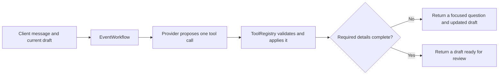

# Backend architecture and technology stack

The Python backend turns one user message into a validated event-draft update. The model proposes one structured tool call; Python validates it, applies it to a copy of the current state, and decides whether to ask the next required question. The model does not save events, schedule notifications, or execute arbitrary external actions.

## Stack and module boundaries

| Component | Role |
| --- | --- |
| Python 3.13 | Backend runtime and workflow orchestration |
| Pydantic 2 | Validates request, state, tool arguments, and event data |
| FastAPI and Uvicorn | HTTP application and local ASGI server |
| httpx | Asynchronous HTTP client for Ollama |
| Ollama | Optional local model provider with tool calling and NDJSON streaming |
| `uv` | Dependency and lockfile management |
| pytest | Backend test runner |

Important source files are under `backend/src/kairos/`: `models/event.py` contains event constraints; `contracts.py` defines shared workflow contracts; `workflow.py` controls each drafting turn; `tools.py` defines tool schemas and handlers; `providers.py` contains the prompt and Ollama adapter; `api.py` adapts the workflow to HTTP/SSE; `__main__.py` provides the CLI; `i18n.py` and `locales/messages.json` define the supported languages and static messages.

## Workflow

Each turn makes at most one model request and accepts exactly one permitted tool call. `EventWorkflow.stream_advance` emits progress before the request and before validation, optional generated text as it arrives, and `completed` only after the proposal has passed validation and been applied. `advance` consumes the same stream for callers that need only the final state. Progress and static errors follow the interface language; generated text and clarifications follow the conversation language.

The Ollama adapter reads streaming NDJSON through `done=true`. Text and structured tool calls are separate channels. It buffers tool-call arguments until the stream finishes, so partial JSON is never executed or shown as the draft. Reasoning (`thinking`) is not exposed. Streamed text is provisional: a late error can follow text already displayed, while the state remains unchanged.

## Tool validation and draft state

`ToolRegistry.schemas(state)` exposes the available schemas. For this event workflow the model can call `update_event_draft` or `ask_event_clarification`. Pydantic rejects undeclared fields (`extra="forbid"`), invalid values, and malformed tool arguments. Python applies accepted changes to a copy of the draft; a failed request leaves the previous state unchanged.

The main event action belongs in the title. Separate before/after activities are represented using `task_operations.add` and `.remove`; removal succeeds only for a unique matching description. A reminder is distinct from an activity. `reminders=null` means the user has not chosen yet, while `[]` means no reminders. When answering a reminder question, the backend restricts the update to reminders; a clock time such as 11:00 is converted to an offset before the event when it can be resolved safely. An offset that would already be in the past is rejected. These checks do not send or schedule notifications.

Date, local time, and IANA timezone are separate values. Missing time is not represented as midnight. Nonexistent or ambiguous local times, inconsistent UTC offsets, and dates that cannot be resolved safely require clarification. Relative dates use the request context's server-side `now` and timezone.

## HTTP and streaming API

`api.py` exposes `GET /health` and `POST /workflow/turn`. Each turn is stateless: the client sends the current `EventWorkflowState`, and the API returns the updated state in an SSE `completed` event. This avoids a server-side session store or database at this stage. The request's timezone and interface language form a `RequestContext`; `now` is created by the server in that timezone. Invalid request bodies and timezones are rejected before streaming starts.

The API translates workflow events into separate SSE names: `progress`, optional `text`, `completed`, and `error`. A shared `httpx.AsyncClient` is created in FastAPI's lifespan when an Ollama model is configured and closed at shutdown. `KAIROS_OLLAMA_MODEL` selects the model; `KAIROS_OLLAMA_BASE_URL` optionally changes the Ollama endpoint. Without a model configuration, a deterministic scripted provider supports a basic API demonstration and does not interpret arbitrary user messages.

## Language behavior

`Language` declares Italian and English. The static message catalog has a complete entry for each language and is validated at startup. The interface language (`RequestContext.language`) is separate from the conversation language (`EventWorkflowState.conversation_language`). The model may propose the conversation language in the same tool call; Python validates and carries it across turns. Neutral or short replies preserve the prior choice. For a substantive message in an unsupported language, the prompt asks the model to use English. This behavior is covered by simulated responses, but a limited real-model evaluation found non-conforming language choices for the tested Qwen configuration; see [prompt evaluation](prompt-evaluation.md).

## Prompt evaluation

The runtime uses the baseline prompt. A single local comparison against a compact candidate found small measured input-token savings but semantic and language regressions. The candidate was not promoted. The [evaluation note](prompt-evaluation.md) and [raw report](../../backend/evals/results/qwen3-8b-prompt-comparison.md) describe the limited sample and its constraints; the results do not establish general model quality or latency.

## Current boundaries

The backend prepares drafts only. It has no database, server-side conversation persistence, authentication, calendar integration, notification delivery, voice input, or mobile UI. The API and CLI are prototype interfaces. Model output remains a proposal that must pass deterministic validation and user review before any future external action.
